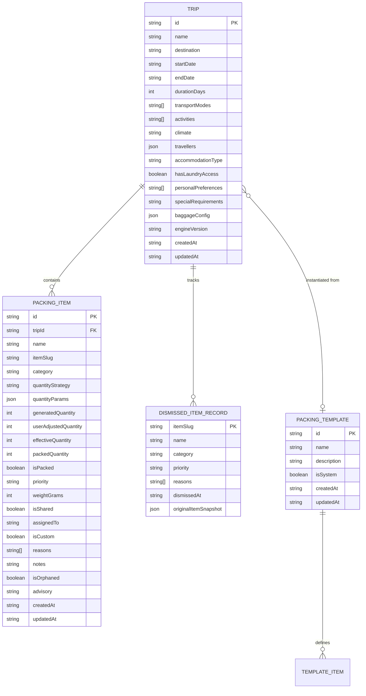

# PackPilot — Data Models & Schema Specification

**Document Reference:** DMS-PACKPILOT-V1  
**Version:** 1.4.0 (Final Milestone 1 Refinement)  
**Status:** Approved for Implementation  

---

## 1. Domain Entity Relationship Diagram



---

## 2. TypeScript Data Model Definitions

### 2.1 Enums & Strategy Types
```typescript
export type TransportMode =
  | 'flight'
  | 'train'
  | 'car'
  | 'bike'
  | 'bus'
  | 'other'

export type TripActivity =
  | 'beach'
  | 'sightseeing'
  | 'trekking'
  | 'adventure'
  | 'business'
  | 'camping'
  | 'family'
  | 'relaxation'

export type ClimateType =
  | 'warm'
  | 'cold'
  | 'rainy'
  | 'mixed'
  | 'unknown'

export type AccommodationType =
  | 'hotel'
  | 'hostel'
  | 'rental'
  | 'camping'
  | 'friends_family'

export interface BaggageConfig {
  hasCabinBaggage: boolean          // Default: true
  cabinWeightLimitKg: number        // Default: 7.0 kg (presets: 7.0, 8.0, 10.0, custom)
  hasCheckedBaggage: boolean        // Default: false
  checkedWeightLimitKg: number      // Default: 23.0 kg (presets: 20.0, 23.0, 32.0, custom)
}

export const DEFAULT_BAGGAGE_CONFIG: BaggageConfig = {
  hasCabinBaggage: true,
  cabinWeightLimitKg: 7.0,
  hasCheckedBaggage: false,
  checkedWeightLimitKg: 23.0,
}

export type PackingCategory =
  | 'documents'
  | 'clothing'
  | 'toiletries'
  | 'electronics'
  | 'gear'
  | 'health'
  | 'miscellaneous'

export type ItemPriority =
  | 'critical'    // Weight = 3 (Passport, Meds, Tickets)
  | 'recommended' // Weight = 2 (Chargers, Sunscreen, Rainwear)
  | 'optional'    // Weight = 1 (Books, Eye mask, Travel pillow)

/**
 * Explicit item-level quantity calculation strategy
 */
export type QuantityStrategy =
  | 'per_person'           // Exactly 1 per person (e.g., Toothbrush, Rain Jacket)
  | 'per_day'              // Daily rate independent of people (e.g., Guidebook, Route plan)
  | 'per_person_per_day'   // Wearables scaled by duration & laundry caps (e.g., Underwear, Socks)
  | 'shared_capacity'      // 1 item per N persons (e.g., 1 Tent per 2 persons, 1 Sunscreen per 3)
  | 'fixed'                // Fixed quantity regardless of parameters (e.g., 1 Multi-plug adapter)
  | 'user_defined'         // Custom item or manual user lock
```

### 2.2 Traveller Composition Model
```typescript
/**
 * Contiguous, non-overlapping traveller age groups
 */
export interface TravellerComposition {
  adults: number      // 18–64 years (min 1 for unaccompanied, default 1)
  teens: number       // 13–17 years (default 0)
  children: number    // 3–12 years (default 0)
  infants: number     // 0–2 years (default 0)
  seniors: number     // 65+ years (default 0)
}

export function getTotalTravellers(t: TravellerComposition): number {
  if (!t || typeof t !== 'object') return 0
  const safeCount = (n: unknown): number => {
    if (typeof n !== 'number' || !Number.isFinite(n) || n <= 0) return 0
    return Math.floor(n)
  }
  return (
    safeCount(t.adults) +
    safeCount(t.teens) +
    safeCount(t.children) +
    safeCount(t.infants) +
    safeCount(t.seniors)
  )
}
```

### 2.3 Dismissed Item Snapshot Model
```typescript
export interface DismissedItemRecord {
  itemSlug: string
  name: string
  category: PackingCategory
  priority: ItemPriority
  reasons: string[]
  dismissedAt: string
  originalItemSnapshot: PackingItem  // Complete state snapshot for lossless restoration
}
```

### 2.4 Trip Entity
```typescript
export interface TripConfig {
  name: string
  destination: string
  startDate: string                  // ISO 8601 YYYY-MM-DD
  endDate: string                    // ISO 8601 YYYY-MM-DD
  transportModes: TransportMode[]
  activities: TripActivity[]
  climate?: ClimateType
  accommodationType?: AccommodationType
  hasLaundryAccess?: boolean         // Explicit user confirmation of laundry facility access
  travellers: TravellerComposition
  personalPreferences?: string[]
  specialRequirements?: string
  baggageConfig?: Partial<BaggageConfig>
}

export interface Trip extends TripConfig {
  id: string
  durationDays: number
  climate: ClimateType
  accommodationType?: AccommodationType
  travellers: TravellerComposition
  totalTravellerCount: number
  personalPreferences: string[]
  baggageConfig: BaggageConfig
  dismissedItems: DismissedItemRecord[] // Preserves full snapshots preventing resurrection
  engineVersion: string
  createdAt: string
  updatedAt: string
}
```

### 2.5 PackingItem Entity
```typescript
export interface QuantityStrategyParams {
  baseUnitsPerDay?: number
  unitsPerPerson?: number      // e.g. 2 passports or 2 water bottles per person
  capacityPerUnit?: number     // e.g. 3 people per bottle of sunscreen
  maxDurationCap?: number      // e.g. 7 days if laundry available
  laundryRotationDays?: number // Item-specific laundry cycle (e.g. 7 days for underwear, 2.5 for pants)
  noLaundryMaxCap?: number     // Item-specific cap when no laundry (e.g. 21 days for underwear)
  bufferUnits?: number         // e.g. +1 extra pair of socks/underwear
  minQuantity?: number
  maxQuantity?: number
}

export interface PackingItem {
  id: string                     // UUID v4
  tripId: string                 // Foreign Key -> Trip.id
  name: string                   // "Underwear (Clean pairs)"
  itemSlug: string               // Canonical identifier (e.g., "wear-underwear")
  category: PackingCategory
  
  // Strategy-Driven Quantities & Partial Packing State
  quantityStrategy: QuantityStrategy
  quantityParams?: QuantityStrategyParams
  generatedQuantity: number      // Calculated by recommendation engine
  userAdjustedQuantity?: number  // Non-null if user explicitly changed quantity
  effectiveQuantity: number      // userAdjustedQuantity ?? generatedQuantity
  packedQuantity: number         // 0 <= packedQuantity <= effectiveQuantity
  isPacked: boolean              // packedQuantity >= effectiveQuantity && effectiveQuantity > 0
  
  priority: ItemPriority
  
  // Physical Weight Metadata (Stored per unit only; Total is derived at runtime)
  weightGrams?: number           // Unit weight in grams (undefined if unknown)
  
  // Multi-Traveller & Attribution
  isShared: boolean              // True if item is shared across travellers
  assignedTo?: string            // Specific traveller tag (e.g., "Infant", "Teen")
  isCustom: boolean              // True if user created manually
  reasons: string[]              // Rationale: ["5-day duration", "Beach activity"]
  notes?: string                 // Custom user note for item
  isOrphaned?: boolean           // True if item is no longer recommended due to removed trip parameters
  advisory?: string              // Advisory warning/explanation for user review
  
  createdAt: string
  updatedAt: string
}
  updatedAt: string
}
```

### 2.6 Template Model
```typescript
export interface TemplateItemConfig {
  name: string
  itemSlug: string
  category: PackingCategory
  quantityStrategy: QuantityStrategy
  quantityParams?: QuantityStrategyParams
  defaultQuantity: number
  priority: ItemPriority
  weightGrams?: number
  isShared: boolean
  reasons: string[]
}

export interface PackingTemplate {
  id: string
  name: string
  description: string
  isSystem: boolean
  defaultTransport?: TransportMode[]
  defaultActivities?: TripActivity[]
  defaultClimate?: ClimateType
  defaultAccommodation?: AccommodationType
  items: TemplateItemConfig[]
  createdAt: string
  updatedAt: string
}
```

### 2.7 Backup & Restore Schema
```typescript
export interface BackupPayload {
  schemaVersion: 1
  exportDate: string
  appVersion: string
  trips: Trip[]
  items: PackingItem[]
  templates: PackingTemplate[]
  settings: Record<string, unknown>
}
```

---

## 3. Storage Abstraction Interfaces (`src/db/interfaces.ts`)

```typescript
export interface ITripsRepository {
  getAllTrips(): Promise<Trip[]>
  getTripById(id: string): Promise<Trip | null>
  saveTripWithItems(trip: Trip, items: PackingItem[]): Promise<void>
  updateTrip(id: string, updates: Partial<Trip>): Promise<void>
  deleteTrip(id: string): Promise<void>
  duplicateTrip(id: string): Promise<Trip>
}

export interface IItemsRepository {
  getItemsForTrip(tripId: string): Promise<PackingItem[]>
  toggleItemPacked(itemId: string, isPacked: boolean): Promise<void>
  updateItemQuantity(itemId: string, userQuantity: number): Promise<void>
  addCustomItem(item: PackingItem): Promise<void>
  dismissItem(tripId: string, itemId: string): Promise<DismissedItemRecord>
  restoreDismissedItem(tripId: string, itemSlug: string): Promise<PackingItem>
  reconcileTripItems(tripId: string, updatedItems: PackingItem[]): Promise<void>
}

export interface ITemplatesRepository {
  getAllTemplates(): Promise<PackingTemplate[]>
  getTemplateById(id: string): Promise<PackingTemplate | null>
  saveTemplate(template: PackingTemplate): Promise<void>
  deleteTemplate(id: string): Promise<void>
}

export interface StorageContext {
  trips: ITripsRepository
  items: IItemsRepository
  templates: ITemplatesRepository
  isStorageAvailable: boolean
  storageType: 'indexeddb' | 'memory'
}
```

---

## 4. Model Invariants & Rules

1. **Effective Quantity Rule:**
   $$\text{effectiveQuantity} = \text{userAdjustedQuantity} \ne \text{undefined} ? \text{userAdjustedQuantity} : \text{generatedQuantity}$$
2. **Weight Calculation:**
   $$\text{totalItemWeightGrams} = \text{weightGrams} \times \text{effectiveQuantity}$$
   If `weightGrams` is undefined, `hasUnknownWeight = true`, and total known weight excludes this item with a disclaimer.
3. **Traveller Count Invariant:**
   $$\text{totalTravellerCount} = \max(1, \text{adults} + \text{teens} + \text{children} + \text{infants} + \text{seniors})$$
4. **Dismissal Preservation:**
   Every dismissed item stores its complete `originalItemSnapshot`, ensuring 100% lossless restoration upon user action.
5. **Partial Packing State Invariant:**
   $$0 \le \text{packedQuantity} \le \text{effectiveQuantity}$$
   $$\text{isPacked} = (\text{packedQuantity} \ge \text{effectiveQuantity}) \land (\text{effectiveQuantity} > 0)$$

