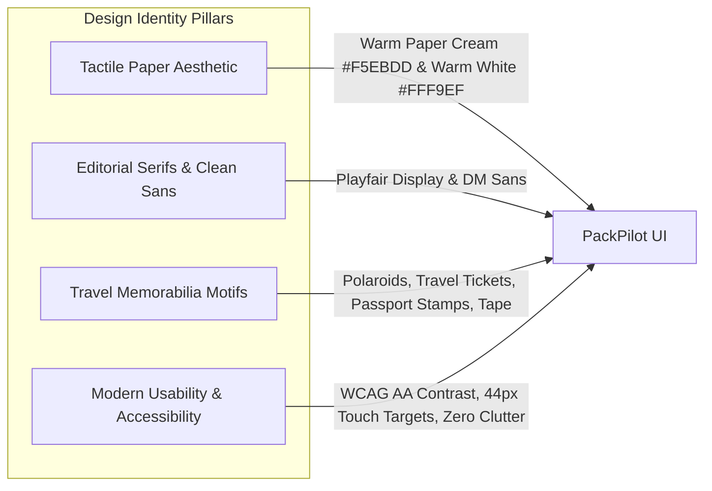

# PackPilot — Design System Specification

**Design Identity:** Travel Scrapbook + Adventure Editorial  
**Document Reference:** DSS-PACKPILOT-V1  
**Version:** 1.0.0  
**Status:** Approved & Implemented in Codebase  

---

## 1. Visual Identity & Creative Direction

PackPilot blends the nostalgia and tactile romance of a well-worn **Travel Scrapbook** with the typographic elegance and structured hierarchy of a high-end **Adventure Editorial Journal**.



---

## 2. Color Palette & Semantic Tokens

| Color Name | Hex Code | Swatch | Semantic Application |
| :--- | :--- | :---: | :--- |
| **Warm Paper Cream** | `#F5EBDD` |  | Base application canvas background. |
| **Warm White** | `#FFF9EF` |  | Cards, sheets, modals, elevated surfaces. |
| **Terracotta** | `#B85C38` |  | Primary action CTAs, critical badges, brand marks. |
| **Dark Terracotta** | `#8F3F26` |  | Hover states, active buttons, high-contrast borders. |
| **Sunshine Yellow** | `#E6B94F` |  | Attention highlights, stars, luggage warnings. |
| **Ink Black** | `#24221F` |  | Editorial typography, deep icons, stamp borders. |
| **Sand** | `#A7A18F` |  | Dividers, dashed ticket lines, muted borders. |
| **Forest Green** | `#244C3B` |  | Nature/outdoor accents, readiness complete status. |

---

## 3. Typography Hierarchy

### 3.1 Font Families
- **Editorial Headings:** `Playfair Display`, Georgia, Cambria, serif.
- **Body & Functional UI:** `DM Sans`, system-ui, -apple-system, sans-serif.
- **Monospace & Metadata:** `ui-monospace`, SFMono-Regular, Menlo, monospace.

### 3.2 Type Scale
```css
/* Editorial Headings (Playfair Display) */
.heading-hero     { font-family: var(--font-heading); font-size: 3.25rem; font-weight: 800; line-height: 1.1; }
.heading-section  { font-family: var(--font-heading); font-size: 2.00rem; font-weight: 700; line-height: 1.2; }
.heading-card     { font-family: var(--font-heading); font-size: 1.25rem; font-weight: 600; line-height: 1.3; }

/* Functional UI (DM Sans) */
.body-large       { font-family: var(--font-body); font-size: 1.125rem; line-height: 1.6; }
.body-base        { font-family: var(--font-body); font-size: 1.000rem; line-height: 1.5; }
.body-small       { font-family: var(--font-body); font-size: 0.875rem; line-height: 1.4; }
.caption          { font-family: var(--font-body); font-size: 0.750rem; letter-spacing: 0.05em; text-transform: uppercase; }
```

---

## 4. Memorabilia Motifs & Decorative Accents

### 4.1 Polaroid Photo Card
- Crisp warm-white photo frame with a wide bottom margin for captions.
- Elevated with a soft ambient shadow (`--shadow-polaroid`) and a subtle $-0.5^{\circ}$ organic rotation on hover.

### 4.2 Washi Tape Overlay (`.scrapbook-tape`)
- Translucent parchment tape element attached at the top-center of cards with semi-transparent borders and subtle rotation ($1^{\circ}$).

### 4.3 Travel Ticket Container (`.ticket-card`)
- Rounded corners (`rounded-ticket: 12px`) with a dashed perimeter border in Sand (`border-sand/70`), reminiscent of vintage train or airline boarding passes.

### 4.4 Passport Stamp Badge (`.btn-stamp` / `Badge[variant="stamp"]`)
- Hard drop shadow (`box-shadow: 2px 2px 0 0 #24221F`), thick 2px solid Ink Black border, and uppercase tracked typography imitating physical rubber stamps.

---

## 5. UI Component Library Architecture

### 5.1 Button Component (`src/components/ui/Button.tsx`)
```typescript
export type ButtonVariant =
  | 'primary'        // Terracotta background, Warm White text
  | 'secondary'      // Warm White background, Sand border, Ink Black text
  | 'forest'         // Forest Green background (Success, Outdoors)
  | 'sunshine'       // Sunshine Yellow background (Highlights)
  | 'outline'        // Transparent with Ink Black 2px border
  | 'stamp'          // Stamped scrapbook button with hard 2px offset shadow
  | 'ghost'          // Borderless with subtle hover background
  | 'terracottaDark' // Deep Terracotta for intense contrast
```

### 5.2 Card Component (`src/components/ui/Card.tsx`)
- Variants: `scrapbook` (standard card), `polaroid` (photo frame), `ticket` (dashed boarding pass), `flat` (simple border).
- Supports `hasTape` boolean prop to display washi tape on top.

### 5.3 Badge Component (`src/components/ui/Badge.tsx`)
- Variants: `terracotta`, `forest`, `sunshine`, `sand`, `stamp`, `outline`.
- Supports optional leading icon.

---

## 6. Accessibility & Responsiveness Principles

1. **Color Contrast:** All body text in Ink Black (`#24221F`) on Warm Paper Cream (`#F5EBDD`) yields a contrast ratio of **12.8:1**, comfortably exceeding the WCAG AAA requirement (7:1).
2. **Keyboard Navigation:** All interactive elements feature visible, high-contrast focus rings (`focus-visible:ring-2 focus-visible:ring-terracotta`).
3. **Touch Targets:** Minimum button and checkbox hit targets of 44px $\times$ 44px on mobile devices.
4. **Motion Sensitivity:** All rotations and transforms respect `prefers-reduced-motion` media queries.
