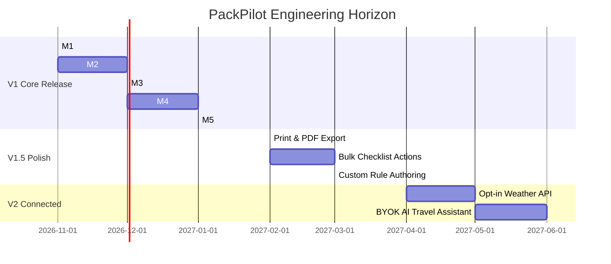

# PackPilot — Development Roadmap & Milestone Planning

**Document Reference:** DRM-PACKPILOT-V1  
**Version:** 1.0.0  
**Status:** Approved  

---

## 1. Product Scope Segmentation: V1 vs V1.5 vs V2

To ensure portfolio-grade polish and steady momentum without scope creep, PackPilot divides features into strict release boundaries:

### V1 – Essential Standalone Product (In-Scope)
- Complete design system implementation (*Travel Scrapbook + Adventure Editorial*).
- Offline-first IndexedDB persistence via Dexie.js.
- Deterministic TypeScript recommendation engine with 12-step pipeline.
- 5-step intuitive Trip Creation Wizard.
- Interactive Packing Checklist with category accordions, custom items, search, and filters.
- Real-time weighted Readiness Score (critical=3, recommended=2, optional=1).
- Luggage Weight Estimator with reference weights and airline threshold warnings.
- Trip Management Dashboard (CRUD, duplicate, past trips).
- Built-in & Custom Template Library.
- Safe JSON backup export and import with schema validation.
- Responsive design for mobile, tablet, and desktop.
- GitHub Pages compatibility via HashRouter.

### V1.5 – Power User Enhancements (Planned)
- Formatted printable checklist view (paper scrapbook print styling).
- Client-side PDF export via `jspdf` or browser print styles.
- Bulk item actions ("Mark all as packed", "Reset category").
- Drag-and-drop item reordering within categories.
- User-authored custom packing rules.

### V2 – Connected Intelligence (Future Scope)
- Opt-in live Weather API integration (e.g. Open-Meteo or WeatherAPI) to override manual climate selection.
- Optional Bring-Your-Own-Key (BYOK) AI Assistant for hyper-specific regional advice (e.g., local electrical plugs or cultural attire guidelines).
- WebShare API integration for sharing checklist snapshots.
- Progressive Web App (PWA) manifest and service worker caching for offline app installation.

### Strictly Out of Scope
- Server-side backend databases (Firebase, Supabase, Postgres).
- User authentication, login credentials, and user tracking.
- Mandatory paid third-party APIs.
- Automatic cross-device cloud synchronization.

---

## 2. V1 Milestone Breakdown

### Milestone 1: Core Domain Engine & Data Layer
- **Focus:** Pure logic, type system, persistence, and unit test suites.
- **Dependencies:** TypeScript, Dexie.js.
- **Deliverables:**
  - TypeScript types and schemas in `src/types/`.
  - Dexie database setup in `src/db/` with `trips`, `items`, `templates`, and `settings` tables.
  - Recommendation engine in `src/engine/` (base, activity, transport, climate, and preference rules).
  - Quantity calculation formulas and deduplication engine.
  - Luggage reference weight lookup table.
  - Readiness scoring engine.
  - Comprehensive unit test suite with 100% engine coverage.
- **Acceptance Criteria:** All engine unit tests pass; Dexie transactions execute reliably in memory.

### Milestone 2: Trip Wizard & Dashboard Management
- **Focus:** Capturing travel parameters and managing trip lifecycles.
- **Dependencies:** Milestone 1, Zustand, React Router.
- **Deliverables:**
  - `useTripStore` in Zustand.
  - 5-Step Trip Creation Wizard (`/wizard/new`) with step validation and animated transitions.
  - Trip Dashboard (`/trips`) with trip cards, progress meters, and delete confirmation modal.
  - Trip duplication utility.
- **Acceptance Criteria:** Users can successfully create, view, duplicate, and delete trips with complete IndexedDB persistence.

### Milestone 3: Interactive Packing Checklist & Dynamic Utilities
- **Focus:** The central user experience during the packing phase.
- **Dependencies:** Milestone 2.
- **Deliverables:**
  - `useChecklistStore` in Zustand.
  - Category accordions with packed counters.
  - Checklist item rows with checkbox toggles, quantity increment/decrement, and reason popovers.
  - Inline custom item creation modal.
  - Item deletion with 5-second undo toast.
  - Dynamic Readiness Score gauge with missing critical item callout banner.
  - Dynamic Luggage Weight Estimator with metric/imperial toggle and airline warnings.
  - Instant text search and status filter chips (`Unpacked`, `Critical`).
- **Acceptance Criteria:** Checkbox toggles and quantity updates update the UI instantaneously and persist to IndexedDB with 300ms debouncing.

### Milestone 4: Templates & Data Backup Hub
- **Focus:** Reusability, peace of mind, and data portability.
- **Dependencies:** Milestone 3.
- **Deliverables:**
  - `useTemplateStore` with 4 pre-built system templates.
  - "Save Trip as Template" action.
  - Templates library page (`/templates`) with item preview modal and "Use Template" action.
  - Data Settings page (`/settings`) with one-click JSON export and drag-and-drop JSON import.
  - Schema validator for import payloads with duplicate handling dialog.
- **Acceptance Criteria:** Users can backup their full database to a JSON file and restore it cleanly on a different browser.

### Milestone 5: Landing Page & Scrapbook Experience Polish
- **Focus:** Public entry point, first impressions, and production release readiness.
- **Dependencies:** Milestones 1–4.
- **Deliverables:**
  - Scrapbook Hero section with primary and secondary CTAs.
  - Interactive "How It Works" feature walkthrough.
  - Sample interactive checklist teaser card on the home page.
  - Responsive header and footer with navigation and GitHub links.
  - Final accessibility audit (WCAG AA contrast, keyboard navigation).
  - GitHub Pages deployment build verification.
- **Acceptance Criteria:** `npm run build` succeeds with zero errors; application deploys seamlessly to GitHub Pages.
