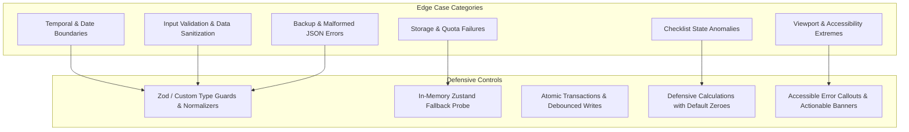

# PackPilot — Edge Cases, Boundary Conditions & Failure Recovery

**Document Reference:** ECB-PACKPILOT-V1  
**Version:** 1.1.0 (Audited & Revised)  
**Status:** Approved  

---

## 1. Overview & Defensive Engineering Philosophy

As a client-side application running in diverse browser runtime environments, PackPilot must gracefully handle user mistakes, device limitations, asynchronous storage interruptions, and malformed data imports without throwing unhandled exceptions or crashing the UI.

---

## 2. Temporal & Date Boundaries

| Edge Case ID | Trigger Condition | System Behavior & Defensive Recovery |
| :--- | :--- | :--- |
| **EC-DATE-01** | `endDate` precedes `startDate` (e.g. Start: Oct 10, End: Oct 02). | Form validation disables "Next" button. Displays inline red error: *"End date must be on or after start date."* Recommendation engine never executes on negative duration. |
| **EC-DATE-02** | `startDate` equals `endDate` (Single-day trip, $D=1$). | Permitted as a valid day trip. Engine sets duration = 1 day, eliminates duplicate clothes, suppresses nightwear/bedding. |
| **EC-DATE-03** | Trip extends across Year Boundary (e.g. Dec 28, 2026 to Jan 04, 2027). | Date parsing utilizes UTC date math (`Date.UTC`) to avoid local timezone daylight savings shift anomalies. Correctly calculates 8 days. |
| **EC-DATE-04** | Trip extends across Leap Day (e.g. Feb 27 to Mar 02 on a leap year). | UTC epoch math correctly accounts for February 29th without crashing date diffing utilities. |
| **EC-DATE-05** | Extreme Duration (e.g., $D > 365$ days). | Engine imposes maximum duration cap of 365 days for UI display, with laundry rotation cap locked at 10 days of clothes. Displays advisory note: *"For long-term journeys, PackPilot plans a rotating capsule wardrobe."* |
| **EC-DATE-06** | Past Dates entered for a new trip. | Permitted with an informational badge: *"This trip is in the past (historical log)."* Allows users to catalog past expeditions. |

---

## 3. Input Validation & Content Anomalies

| Edge Case ID | Trigger Condition | System Behavior & Defensive Recovery |
| :--- | :--- | :--- |
| **EC-INP-01** | Trip title with 200+ characters or emoji spam. | Input length hard-capped at 80 characters. UI elements apply CSS `truncate` and `break-words` to prevent layout deformation. |
| **EC-INP-02** | Special characters in Destination (e.g., `<script>`, symbols, Unicode). | Inputs are sanitized and stored as plain text. React JSX auto-escapes string literals preventing XSS injection. |
| **EC-INP-03** | User unchecks all transport modes or activities. | Wizard requires at least 1 transport and 1 activity to proceed. Next button is disabled with prompt tooltip. |
| **EC-INP-04** | Empty Recommendation Result set. | Universal Base Essentials guarantee baseline items. In the extreme event that 0 items are generated, safety fallback injects: Wallet, Identification, Phone, and Charger, displaying an alert: *"Essential fallback items loaded."* |

---

## 4. Checklist State & Operational Anomalies

| Edge Case ID | Trigger Condition | System Behavior & Defensive Recovery |
| :--- | :--- | :--- |
| **EC-CHK-01** | User manually deletes all items in a category. | Category accordion renders an empty state card: *"No items in this category. Click '+ Add Custom Item' to add one."* |
| **EC-CHK-02** | User attempts to delete a critical item (e.g. Passport, Medication). | Triggers a safety confirmation dialog: *"This is a Critical Travel Essential. Are you sure you want to remove it?"* If confirmed, the item is moved to a collapsible "Dismissed Essentials" drawer. The Readiness Score displays an advisory badge (*"1 critical essential dismissed"*), preventing a false 100% "Ready for Adventure" stamp. |
| **EC-CHK-03** | User sets item quantity to 0 or negative via keyboard input. | Input handler clamps value: $Q = \max(1, \min(99, \text{parsedValue}))$. |
| **EC-CHK-04** | Rapid clicking on checkbox (10 clicks in 1 second). | In-memory Zustand state updates synchronously; IndexedDB persistence write is debounced by 300ms, executing only the final state to eliminate database locking. |
| **EC-CHK-05** | User edits trip parameters after checking off 80% of items. | Intelligent non-destructive reconciliation: Items matching canonical `itemSlug` preserve their `isPacked` status and custom user notes. Items present in `trip.dismissedItemSlugs` are NOT resurrected. Only genuine new additions are inserted. |

---

## 5. Storage, Quota & Browser Environment Failures

| Edge Case ID | Trigger Condition | System Behavior & Defensive Recovery |
| :--- | :--- | :--- |
| **EC-STO-01** | Private / Incognito browsing where IndexedDB throws `SecurityError` or is disabled. | System runs a startup probe `probeIndexedDB()`. If unavailable, `isStorageAvailable` flag is set to false. Zustand repositories bypass Dexie calls and hold data in-memory. Renders a persistent sticky alert: *"Private browsing detected: Changes will be lost on tab close. Export JSON to save your work."* |
| **EC-STO-02** | Storage Quota Exceeded (`QuotaExceededError`). | Catch block alerts user: *"Browser storage is full. Please export your backup JSON and clear older trips."* Disables new trip creation until storage is freed. |
| **EC-STO-03** | Browser Tab Closed Mid-Transaction. | All multi-table updates are wrapped in `db.transaction('rw', ...)` to guarantee atomic commits. No orphaned or partially-saved records. |
| **EC-STO-04** | IndexedDB Database Version Upgrade Conflict (two tabs open on different versions). | Dexie `on('versionchange')` handler prompts user to reload the tab: *"PackPilot updated in another tab. Please reload."* |

---

## 6. Backup & Malformed JSON Import Errors

| Edge Case ID | Trigger Condition | System Behavior & Defensive Recovery |
| :--- | :--- | :--- |
| **EC-BAK-01** | User uploads a non-JSON file (e.g. `.png` or `.pdf`). | File reader catches MIME type mismatch and parsing errors. Displays error alert: *"Please select a valid .json PackPilot backup file."* |
| **EC-BAK-02** | Truncated or corrupt JSON string. | `JSON.parse` wrapped in `try/catch`. Displays error alert: *"The backup file is damaged and could not be parsed."* |
| **EC-BAK-03** | Missing required top-level schema fields (`version`, `trips`, `items`). | Schema validator rejects file: *"Incompatible backup format. Missing schema version or trip tables."* No database write occurs. |
| **EC-BAK-04** | Backup contains trips with existing duplicate IDs. | Import dialog offers: 1) Overwrite existing trips, 2) Regenerate new UUIDs for incoming trips, 3) Cancel. |
| **EC-BAK-05** | Backup contains malicious payload properties (`__proto__`, script tags). | Sanitizer strips unrecognized prototype properties and validates field types before committing to IndexedDB. |

---

## 7. Responsive & Viewport Extremes

| Edge Case ID | Trigger Condition | System Behavior & Defensive Recovery |
| :--- | :--- | :--- |
| **EC-RES-01** | Ultra-narrow smartphone screen (320px width, e.g. iPhone SE 1st gen). | Layout collapses multi-column grids into single columns; padding shrinks from `p-6` to `p-3`; typography scales to fit without horizontal window scrolling. |
| **EC-RES-02** | Extremely long item name (e.g. 50-word custom prescription medicine name). | Item label applies CSS `break-words` and `hyphens: auto` to prevent pushing action buttons off-screen. |
| **EC-RES-03** | High browser zoom level (300%–500% zoom for visual accessibility). | Flex layouts wrap gracefully; sticky headers switch to static flow if viewport height $< 400\text{px}$. |
