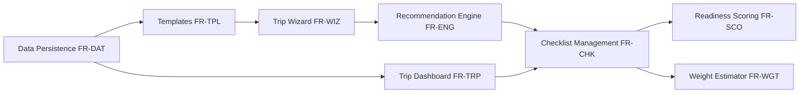

# PackPilot — Functional Requirements Specification

**Document Reference:** FRS-PACKPILOT-V1  
**Version:** 1.0.0  
**Status:** Approved  

---

## 1. Overview & Traceability Matrix

This specification details the granular functional requirements for all PackPilot V1 modules. Each requirement is assigned a permanent identifier (`FR-XXX-YY`) used across QA test cases and acceptance test suites.

---

## 2. Module 1: Trip Creation Wizard (FR-WIZ)

### FR-WIZ-01: Multi-Step Wizard Flow
- **Description:** The system shall guide the user through a sequential 5-step wizard to configure travel parameters.
- **Inputs:** Step index (1 through 5), step state data.
- **Validation:** User cannot advance from Step 1 without valid mandatory fields.
- **Acceptance Criteria:**
  - Back and Next buttons permit bi-directional navigation without loss of entered step data.
  - Step progress indicator displays current step and completed step indicators.

### FR-WIZ-02: Mandatory Trip Basics Validation
- **Description:** Step 1 requires Trip Name, Destination, Start Date, and End Date.
- **Validation Rules:**
  - `tripName`: 1 to 80 characters, trimmed of leading/trailing whitespace.
  - `destination`: 1 to 100 characters.
  - `startDate`: Valid ISO 8601 date (`YYYY-MM-DD`). Cannot be empty.
  - `endDate`: Valid ISO 8601 date (`YYYY-MM-DD`). Must be $\ge$ `startDate`.
- **Error Handling:** If `endDate` < `startDate`, show immediate inline error: *"End date cannot be earlier than start date."*

### FR-WIZ-03: Transport Mode Selection
- **Description:** User selects one or more transport modes: `Flight`, `Train`, `Car`, `Bike`, `Bus`, `Other`.
- **Validation Rules:** At least one transport mode must be selected.
- **Acceptance Criteria:** Multiple selections allowed (e.g. Flight + Car). Selecting `Flight` automatically activates airline-specific packing rules (cabin baggage liquid rules, passport security).

### FR-WIZ-04: Travel Purpose & Activities Selection
- **Description:** User selects one or more activities: `Beach`, `Sightseeing`, `Trekking`, `Adventure`, `Business`, `Camping`, `Family trip`, `Relaxation`.
- **Validation Rules:** At least one activity must be selected.
- **Acceptance Criteria:** Each selected activity injects its dedicated equipment and clothing rules into the recommendation pipeline.

### FR-WIZ-05: Climate & Weather Selection
- **Description:** User selects expected weather: `Warm`, `Cold`, `Rainy`, `Mixed`, `Unknown`.
- **Validation Rules:** Optional; defaults to `Unknown` if not specified.
- **Acceptance Criteria:** If `Cold` is chosen, thermal layers and insulated wear are included; if `Rainy` or `Mixed` is chosen, rain protection gear is included.

### FR-WIZ-06: Companions, Accommodations & Preferences
- **Description:** Optional parameters for travellers and personal needs:
  - `travellerCount`: Integer between 1 and 20 (default: 1).
  - `ageGroups`: Multi-select (`Infants`, `Children`, `Teens`, `Adults`, `Seniors`).
  - `accommodationType`: Single-select (`Hotel`, `Hostel`, `Rental/Airbnb`, `Camping Tent`, `Friends/Family`).
  - `personalPreferences`: Checkbox array (`Medications`, `Work Tech Kit`, `Contact Lenses`, `Photography Gear`, `Formal Wear`, `Laundry Access Available`).
  - `specialRequirements`: Free-text field (up to 500 characters).

---

## 3. Module 2: Recommendation Engine (FR-ENG)

### FR-ENG-01: Pure Function Execution
- **Description:** The engine must be a pure TypeScript function devoid of UI imports, DOM manipulation, or asynchronous side-effects:
  `runRecommendationEngine(input: TripConfig): PackingItem[]`

### FR-ENG-02: Base Essentials Generation
- **Description:** Automatically inject foundational travel items:
  - Identification/Passport, Government ID, Wallet/Credit Cards, Cash.
  - Mobile phone charger, universal adapter (if international flag or unknown).
  - Basic dental hygiene (toothbrush, toothpaste).
  - Underwear, socks, sleepwear scaled to duration.

### FR-ENG-03: Dynamic Quantity Calculation
- **Description:** Item quantities scale logically based on duration $D = (\text{endDate} - \text{startDate} + 1)$ days:
  - If $D = 1$: Underwear = 1, Shirts = 1, Pants = 1.
  - If $2 \le D \le 7$: Underwear = $D + 1$, Shirts = $D$, Pants = $\lceil D / 2 \rceil$.
  - If $D > 7$ and `laundryAccess = true`: Underwear capped at 7, Shirts capped at 6, Pants capped at 3.
  - If $D > 7$ and `laundryAccess = false`: Underwear capped at 10, Shirts capped at 8, Pants capped at 5.

### FR-ENG-04: Activity Rule Injections
- **Beach:** Swimwear ($\times 2$), Quick-dry towel, Sunscreen SPF 50+, Sunglasses UV400, Beach bag, Flip-flops/sandals.
- **Trekking:** Trail boots/hiking shoes, Moisture-wicking socks ($\times 3$), Trekking poles, Hydration pack/water bladder, Blister prevention tape, Portable multi-tool, Headlamp + spare batteries.
- **Camping:** Sleeping bag, Tent + stakes, Sleeping mat, Camping stove/fuel, Biodegradable soap, Insect repellent, Matches/lighter in waterproof case.
- **Business:** Formal shirts/blouses ($\times 3$), Blazer/suit jacket, Dress shoes, Laptop + charger, Presentation clicker, Business cards.
- **Sightseeing:** Comfortable walking shoes, Daypack/crossbody bag, Portable power bank, City map/guidebook.
- **Bike / Motorcycle:** DOT/ECE helmet, Riding gloves, Protective jacket/pants, Rain oversuit, Bike tool kit, Chain lube, Puncture kit.

### FR-ENG-05: Deduplication & Conflict Resolution
- **Description:** If two rules recommend the same item (e.g. Beach recommends "Sunglasses" and Trekking recommends "UV Sunglasses"), the engine merges them into a single item:
  - Retains highest priority (`critical` > `recommended` > `optional`).
  - Retains highest suggested quantity.
  - Combines reasons (e.g., *"Recommended for Beach and Trekking"*).
  - Assigns unique canonical key `item_slug` (e.g., `gear-sunglasses`).

---

## 4. Module 3: Checklist Management (FR-CHK)

### FR-CHK-01: Category Grouping
- **Description:** Items are grouped into 7 fixed categories: `Documents`, `Clothing`, `Toiletries`, `Electronics`, `Gear`, `Health`, `Miscellaneous`.
- **Acceptance Criteria:** Each category header shows packed count vs total count (e.g., "Clothing (4/7 packed)") and can be collapsed or expanded.

### FR-CHK-02: Item Status & Quantity Toggle
- **Description:** Clicking an item checkbox toggles `isPacked` between `true` and `false`.
- **Acceptance Criteria:** State updates immediately in memory and triggers debounced persistence to IndexedDB within 300ms.
- **Quantity Controls:** `+` and `-` buttons increase/decrease quantity between 1 and 99.

### FR-CHK-03: Custom Item Creation
- **Description:** User can add a custom item to any category.
- **Inputs:** Name (required, 1-60 chars), category (required), quantity (default: 1), priority (default: `recommended`), estimated weight (optional, grams).
- **Acceptance Criteria:** Custom item is flagged with `isCustom: true` and persists across sessions.

### FR-CHK-04: Item Deletion with Undo Toast
- **Description:** User can delete any item.
- **Acceptance Criteria:** System presents an immediate floating toast with an "Undo" action for 5 seconds. If undo is clicked, item is restored in its original position and packed state.

### FR-CHK-05: Search & Filter Controls
- **Description:** Real-time text search filters visible items across all categories.
- **Filter Chips:**
  - `All Items`
  - `Unpacked Only` (hides already packed items to focus on what remains)
  - `Critical Only` (shows only items with priority = `critical`)
  - `Category Pills` (jump to or isolate category)

---

## 5. Module 4: Trip Management & Dashboard (FR-TRP)

### FR-TRP-01: Trip Card Listing
- **Description:** Displays all stored trips sorted by `startDate` ascending.
- **Card Elements:** Trip title, destination, dates, duration badge, transport icons, progress bar (% packed), readiness score badge.

### FR-TRP-02: Trip Duplication
- **Description:** Creates an exact clone of the target trip with:
  - New unique ID.
  - Title prefixed with "Copy of [Trip Name]".
  - All items preserved but `isPacked` reset to `false`.

### FR-TRP-03: Trip Deletion Confirmation
- **Description:** Deleting a trip requires explicit confirmation in an accessible modal dialog.
- **Acceptance Criteria:** Clicking "Confirm Delete" permanently purges the trip and its items from IndexedDB.

---

## 6. Module 5: Template Engine (FR-TPL)

### FR-TPL-01: Pre-defined System Templates
- **Description:** Ships with 4 immutable built-in templates (*Weekend Getaway*, *Business Express*, *Alpine Trek*, *Beach Sun*).
- **Acceptance Criteria:** Users can preview template items and click "Use Template" to spawn a new trip pre-filled with the template's parameters and item list.

### FR-TPL-02: Save Trip as Custom Template
- **Description:** User can snapshot any active trip's item checklist into a reusable custom template.
- **Acceptance Criteria:** User provides a Template Name and Description. Custom templates can be updated or deleted by the user.

---

## 7. Module 6: Scoring & Weight Estimators (FR-SCO / FR-WGT)

### FR-SCO-01: Weighted Readiness Score Calculation
- **Description:** Calculates percentage:
  $$\text{Score} = \text{round}\left( \frac{\sum_{\text{packed}} W_i}{\sum_{\text{active}} W_i} \times 100 \right)$$
  Weights: `critical` = 3, `recommended` = 2, `optional` = 1.
- **Acceptance Criteria:**
  - Score updates dynamically upon every checkbox toggle.
  - If any critical item is unpacked, display a warning callout: *"X critical items remaining!"*

### FR-WGT-01: Estimated Luggage Weight
- **Description:** Computes:
  $$\text{TotalWeightKg} = \sum_{i} \left( \frac{\text{unitWeightGrams}_i \times \text{quantity}_i}{1000} \right)$$
- **Acceptance Criteria:**
  - Displays dual metrics: Kilograms (e.g. `6.4 kg`) and Pounds (e.g. `14.1 lbs`).
  - If total weight $> 7.0\text{ kg}$, shows advisory note for airline cabin restrictions.

---

## 8. Module 7: Data Persistence & Backup (FR-DAT)

### FR-DAT-01: IndexedDB Local Storage
- **Description:** Uses Dexie.js with tables: `trips`, `items`, `templates`, `settings`.
- **Acceptance Criteria:** Performs fast transactional reads/writes with zero server dependencies.

### FR-DAT-02: JSON Backup Export
- **Description:** Serializes all database tables into a single JSON file formatted according to the PackPilot Backup Schema v1.0, triggering an automatic file download.

### FR-DAT-03: JSON Backup Import & Validation
- **Description:** Allows user to upload a `.json` backup file.
- **Validation:** Verifies file schema version, validates record structures.
- **Conflict Handling:** Prompts user to select:
  1. *Merge & Overwrite* (updates existing trips matching ID, appends new ones).
  2. *Clean Restore* (wipes local DB and replaces with backup data).
  3. *Cancel*.
