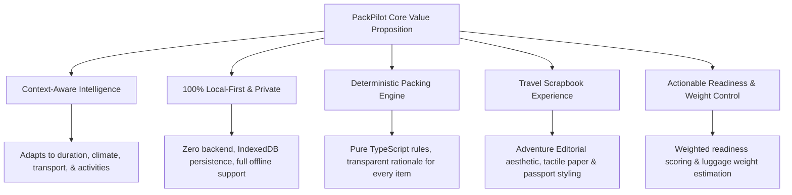

# PackPilot — Product Vision Document

**Product Name:** PackPilot – Your Personal Travel Assistant  
**Tagline:** *Plan smarter. Pack better. Travel lighter.*  
**Document Version:** 1.0.0  
**Status:** Approved for Implementation  
**Audience:** Product Engineering, QA, UX Design, Solution Architecture  

---

## 1. Executive Summary & Problem Statement

Travel should evoke excitement, curiosity, and discovery. Yet for millions of travellers worldwide, the preparation phase is characterized by friction, cognitive overload, anxiety, and last-minute panic:

1. **The Fear of Forgetting:** Travellers constantly worry about leaving behind vital medication, chargers, travel documents, or specialized clothing.
2. **Overpacking & Baggage Penalties:** Uncertainty regarding destination weather and unplanned activities results in heavy bags, unnecessary physical strain, and costly airline baggage fees.
3. **Generic & Irrelevant Checklists:** Traditional online packing lists are static printables or generic blog posts (e.g., "50 Things Every Traveler Needs") that fail to adapt to trip duration, transport restrictions, specific climates, or travel companions.
4. **Privacy & Cloud Fatigue:** Many modern travel apps mandate account creation, third-party tracking, paid subscriptions, or constant internet connectivity, alienating privacy-conscious travellers and failing when packing in low-connectivity environments (e.g., remote trailheads or subterranean transit).

**PackPilot** is an intelligent, frontend-only personal travel assistant that synthesizes trip parameters—destination, duration, transport mode, activities, expected weather, and personal preferences—into a customized, deterministic, and interactive travel scrapbook packing checklist. It operates with zero backend dependencies, preserving 100% privacy and local-first reliability.

---

## 2. Core Value Proposition

PackPilot bridges the gap between chaotic physical packing and thoughtful travel readiness through five core pillars:

1. **Context-Aware Recommendations:** Packing requirements scale dynamically whether the journey is an overnight train business trip, a 10-day beach-and-mountain adventure, or a multi-generational family expedition.
2. **100% Local-First & Zero Lock-In:** User data resides solely in the browser's IndexedDB. No logins, no tracking cookies, no server outages. Users retain complete ownership through seamless JSON import and export backups.
3. **Transparent & Deterministic Engine:** Every suggested item comes with a human-readable explanation (e.g., *"Recommended because you selected Flight transport + International travel"* or *"Quantity adjusted to 4 pairs for a 5-day trip"*).
4. **Delightful Travel Scrapbook Aesthetic:** Far from an aseptic spreadsheet, PackPilot immerses users in an *Adventure Editorial* aesthetic reminiscent of curated field journals, polaroids, postal stamps, and tactile paper artifacts.
5. **Actionable Readiness & Weight Estimator:** A transparent readiness metric that prioritizes non-negotiable critical essentials without penalizing skipped optional novelties, accompanied by luggage weight estimation.

---

## 3. Target Audience & User Personas

### Persona 1: The Adventure Weekend Hiker ("Devin")
- **Profile:** 28, Software Developer, weekend trekker and camper.
- **Pain Point:** Frequently forgets crucial technical gear (headlamps, water purification tablets, blister pads) or packs regular clothes that get soaked.
- **Needs in PackPilot:** Quick selection of "Trekking" and "Camping" with car/bike transport, packing gear checklists with weight calculations, and custom gear items.

### Persona 2: The Fast-Paced Business Traveller ("Ananya")
- **Profile:** 35, Strategy Consultant, 2–3 flights per week.
- **Pain Point:** Must travel strictly cabin-only (under 7kg or 8kg) and cannot afford to pack prohibited liquids or forget travel adapters and presentation clickers.
- **Needs in PackPilot:** Carry-on compliance filtering, flight transport liquid restrictions, formal wear protection rules, luggage weight estimators, and reusable business trip templates.

### Persona 3: The Family Vacation Planner ("Carlos & Elena")
- **Profile:** Late 30s, parents travelling with a 4-year-old child and a grandparent.
- **Pain Point:** Managing checklists across diverse age groups with completely different needs (diapers, pediatric medication, accessibility aids, entertainment).
- **Needs in PackPilot:** Multi-traveller categorization, custom tags, dedicated medication and document tracking, and exportable/printable readiness summaries.

### Persona 4: The Mindful Minimalist Nomad ("Sora")
- **Profile:** 24, Digital Nomad travelling for 3 to 6 months across mixed climates.
- **Pain Point:** Laundry cycle optimization. Long trips shouldn't mean packing 90 shirts.
- **Needs in PackPilot:** Duration caps based on laundry assumption rules, versatile multi-use item suggestions, and transparent quantity calculation formulas.

---

## 4. Product Principles & Philosophy

1. **Respect User Agency & Privacy Above All:**
   - The user owns their data. Data never leaves the browser.
   - We do not demand gender inputs. Personal care, hygiene, and wellness items are selected based on explicit personal preferences rather than arbitrary demographic stereotyping.
2. **Deterministic & Explainable Over Black-Box Magic:**
   - V1 does not rely on opaque generative AI hallucinations or network-dependent APIs. Every recommendation is traceable to a clear, tested TypeScript rule with an explicit reason.
3. **Tactile Craftsmanship in Digital UI:**
   - Digital utilities can be beautiful. By employing paper cream (#F5EBDD), terracotta accents, vintage ticket aesthetics, and editorial serif headlines, PackPilot makes trip preparation a ritual rather than a chore.
4. **Resilient Offline-First Architecture:**
   - Travellers pack in basements, hotel rooms with spotty Wi-Fi, and airplanes. PackPilot must load and operate seamlessly without an active internet connection after initial asset caching.
5. **Zero Inherent Clutter (Progressive Disclosure):**
   - The trip wizard asks for only what is required to produce a valid list (destination, dates, transport, activities). Advanced options (age groups, climate overrides, custom preferences) are available on demand without overwhelming the user.

---

## 5. Strategic Roadmap Overview (V1 → V1.5 → V2)

| Phase | Strategic Goal | Core Deliverables | Constraints |
| :--- | :--- | :--- | :--- |
| **V1 (Current)** | **Standalone Local Utility** | Wizard, Rule Engine, Checklist, Offline Storage (Dexie), Templates, Readiness Score, Weight Estimator, JSON Backup. | Zero backend, 100% client-side, GitHub Pages compatible. |
| **V1.5** | **Power-User Enhancements** | Print-friendly itinerary export, PDF checklist generation, dark paper theme option, bulk item actions, custom rule authoring. | Remains frontend-only and local-first. |
| **V2** | **Connected Intelligence** | Live Weather API integration (opt-in), optional BYOK (Bring-Your-Own-Key) AI assistant for hyper-local packing tips, WebShare API, PWA installability. | Non-breaking progressive enhancement; offline fallback preserved. |

---

## 6. Success Metrics & Quality Standards

- **Functional Correctness:** 100% deterministic test coverage across all rule pipelines, quantity calculators, and deduplication logic.
- **Data Integrity:** 0% data loss during page reloads, tab closures, or browser restarts via IndexedDB transactions.
- **Performance:** First Contentful Paint (FCP) < 1.0s, Time to Interactive (TTI) < 1.2s on standard mobile connections.
- **Accessibility:** WCAG 2.1 Level AA compliance across all contrast ratios, keyboard navigation paths, and screen reader announcements.
- **Zero Lock-in:** 1-click full JSON export that validates cleanly on import across different browsers and devices.
