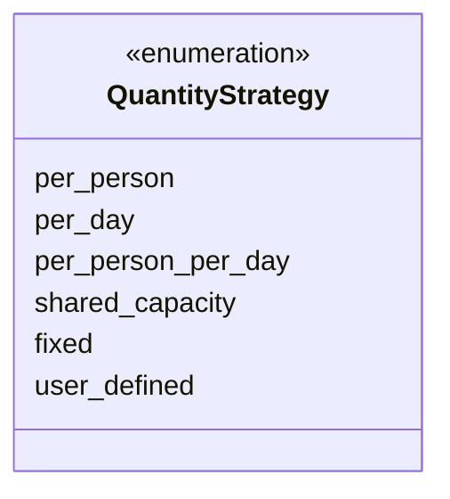
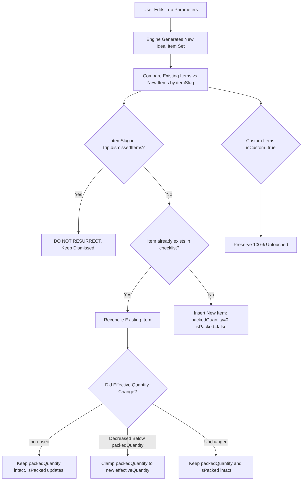

# PackPilot — Recommendation Engine Specification

**Document Reference:** RES-PACKPILOT-V1  
**Version:** 1.4.0 (Final Milestone 1 Refinement)  
**Status:** Implementation Ready (Awaiting Final PO Approval)  

---

## 1. Engine Philosophy: Determinism Over Black-Box Magic

PackPilot utilizes a **Deterministic, Rule-Based TypeScript Pipeline** that guarantees:
1. **100% Predictability:** Identical inputs produce identical outputs every single run.
2. **Complete Explainability:** Every recommended item carries an audit trail of human-readable reasons.
3. **Execution Performance:** Pure in-memory computation running in $< 50\text{ms}$ on standard mobile hardware with zero external API calls.


---

## 2. Quantity Strategy Architecture & Item-Specific Laundry Caps

PackPilot rejects arbitrary universal duration caps (such as a blanket 14-day limit). Instead, **each item rule defines its own duration behavior, laundry rotation cycle, and long-trip scaling policy**:



### Strategy 1: `per_person`
- **Definition:** Exactly one unit per eligible traveller.
- **Formula:**
  $$Q = \text{targetTravellerCount}$$
- **Long-Trip Behavior:** Invariant to duration. (e.g. 1 rain jacket per person whether the trip is 3 days or 60 days).
- **Examples:**
  - Toothbrush: $1 \times \text{totalTravellers}$
  - Ankle-support trekking boots: $1 \times \text{totalTravellers}$
  - Rain jacket: $1 \times \text{totalTravellers}$

### Strategy 2: `per_day`
- **Definition:** Quantities scale directly with trip calendar days $D$, independent of the number of travellers.
- **Formula:**
  $$Q = \max(1, D \times \text{unitsPerDay})$$
- **Long-Trip Behavior:** Grows linearly with duration unless bounded by an item-specific cap.
- **Examples:**
  - Daily trail snacks: $1 \times D$
  - Daily disposable lens pairs: $1 \times D \text{ (per lens wearer)}$

### Strategy 3: `per_person_per_day` (Item-Specific Laundry Scaling)
- **Definition:** Wearables scaled by duration and rotated based on laundry access, multiplied by eligible travellers.
- **Item-Specific Laundry Parameters:**
  - **Underwear:**
    - If `hasLaundry = true`: Rotates on a **7-day cycle**. $Q = (\min(D, 7) + 1) \times N_{\text{travellers}}$.
    - If `hasLaundry = false`: Scales up to an **item-specific max cap of 21 days**. For trips longer than 21 days without laundry, caps at 22 pairs with an advisory note to wash essentials.
  - **Socks:**
    - If `hasLaundry = true`: Rotates on a **7-day cycle**. $Q = (\min(D, 7) + 1) \times N_{\text{travellers}}$.
    - If `hasLaundry = false`: Caps at **14 days**.
  - **Shirts / Tops:**
    - If `hasLaundry = true`: Rotates on a **5-day cycle**. $Q = \min(D, 5) \times N_{\text{travellers}}$.
    - If `hasLaundry = false`: Caps at **10 shirts**.
  - **Pants / Bottoms:**
    - If `hasLaundry = true`: $Q = \max(1, \lceil \min(D, 7) / 2.5 \rceil) \times N_{\text{travellers}}$ (typically 3 pairs max).
    - If `hasLaundry = false`: Caps at **5 pairs**.
  - **Sleepwear:**
    - $Q = \max(1, \lceil \min(D, 14) / 4 \rceil) \times N_{\text{travellers}}$ (typically 2–3 pairs).

### Strategy 4: `shared_capacity` (Group Consumption & Long-Trip Replenishment)
- **Definition:** Items shared across travellers up to a capacity threshold $C$ and consumed over a replenishment cycle $T_{\text{cycle}}$.
- **Formula:**
  $$Q = \left\lceil \frac{\text{totalTravellers}}{C} \right\rceil \times \left\lceil \frac{D}{T_{\text{cycle}}} \right\rceil$$
- **Examples:**
  - **Sunscreen SPF 50 ($C=3$, $T_{\text{cycle}} = 10\text{ days}$):**
    - 3 travellers for 7 days: $1 \times 1 = 1$ bottle.
    - 3 travellers for 25 days: $1 \times 3 = 3$ bottles.
  - **Toothpaste ($C=3$, $T_{\text{cycle}} = 14\text{ days}$):**
    - 4 travellers for 30 days: $2 \times 3 = 6$ travel tubes (or advisory to carry full-sized).
  - **Camping Tent ($C=2$, $T_{\text{cycle}} = \infty$):**
    - $\lceil \text{travellers} / 2 \rceil$ tents (independent of duration).

### Strategy 5: `fixed`
- **Definition:** Constant count regardless of duration or traveller count.
- **Examples:** Universal travel adapter (1, or 2 if work tech checked), vehicle document pouch (1).

### Strategy 6: `user_defined`
- **Definition:** Custom items added manually by user or items where the user overrode the quantity.

---

## 3. Traveller Composition & Age-Specific Rules

PackPilot supports five contiguous, non-overlapping age brackets:

```typescript
export interface TravellerComposition {
  adults: number      // 18–64 years
  teens: number       // 13–17 years
  children: number    // 3–12 years
  infants: number     // 0–2 years
  seniors: number     // 65+ years
}
```

### Age-Specific Rules & Formulas:
1. **Infants ($0 \le \text{age} \le 2$):**
   - **Diapers:** Strategy `per_person_per_day`. Formula: $4 \text{ diapers/day} \times D \times N_{\text{infants}}$, hard-capped at 24 with an advisory note to purchase locally on arrival.
   - **Baby Wipes (100-pack):** Strategy `shared_capacity` ($C=1$ per 7 days). $\lceil D / 7 \rceil \times N_{\text{infants}}$.
   - **Travel Stroller / Carrier:** Strategy `per_person` ($1 \times N_{\text{infants}}$, max 2).
   - **Formula / Feeding Bottles:** Strategy `per_person` ($2 \times N_{\text{infants}}$).
2. **Children ($3 \le \text{age} \le 12$):**
   - **Kids Entertainment / Activity Books:** Strategy `per_person` ($1 \times N_{\text{children}}$).
   - **Kids Sun Hat / Swimwear:** Strategy `per_person` ($2 \times N_{\text{children}}$ for beach).
3. **Teens ($13 \le \text{age} \le 17$):**
   - **Personal Tech Charger & Headphones:** Strategy `per_person` ($1 \times N_{\text{teens}}$).
   - **Teen Daypack / Personal Carry Bag:** Strategy `per_person` ($1 \times N_{\text{teens}}$).
   - Clothing rules scale identical to adult quantities.
4. **Adults ($18 \le \text{age} \le 64$):**
   - Business attire, formal shoes, and work tech scale strictly against $N_{\text{adults}}$.
5. **Seniors ($\text{age} \ge 65$):**
   - **Daily Medication Pill Organizer:** Strategy `per_person` ($1 \times N_{\text{seniors}}$).
   - **Comfort Supportive Footwear:** Strategy `per_person` ($1 \times N_{\text{seniors}}$).
   - **Emergency Medical / Insurance Card:** Strategy `per_person` ($1 \times N_{\text{seniors}}$).

---

## 4. Partial Packing State & Reconciliation Machine

PackPilot provides first-class support for **partial packing**, tracking both required quantities and packed progress:

```typescript
// On PackingItem
generatedQuantity: number      // Calculated by recommendation engine
userAdjustedQuantity?: number  // Non-null if user explicitly changed quantity
effectiveQuantity: number      // userAdjustedQuantity ?? generatedQuantity
packedQuantity: number         // 0 <= packedQuantity <= effectiveQuantity
isPacked: boolean              // packedQuantity >= effectiveQuantity && effectiveQuantity > 0
```

### Clamping & Reconciliation Behavior on Trip Edits (`mergeChecklists`):



### Detailed Event Rules:
1. **Quantity Increased ($Q_1 \rightarrow Q_2$, $Q_2 > Q_1$):**
   - `effectiveQuantity` updates to $Q_2$.
   - `packedQuantity` is strictly preserved (e.g., if user had packed 3 of 3, and quantity becomes 5, `packedQuantity` remains 3, and `isPacked` becomes `false`).
   - `remainingQuantity` becomes $5 - 3 = 2$.
2. **Quantity Decreased ($Q_1 \rightarrow Q_2$, $Q_2 < Q_1$):**
   - `effectiveQuantity` updates to $Q_2$.
   - **Clamping Rule:** If `packedQuantity > Q_2`, `packedQuantity` clamps cleanly:
     $$\text{packedQuantity} = \min(\text{packedQuantity}, Q_2)$$
   - `isPacked` becomes `true` (since $\text{packedQuantity} \ge Q_2$).
   - A friendly toast notification advises: *"Quantity updated to 3. Already packed items adjusted."*
3. **Custom Items (`isCustom: true`):**
   - Completely untouched.
4. **Dismissed Items (`trip.dismissedItems`):**
   - Permanently suppressed from regeneration. Never resurrected as zombie items.
5. **Dismissed Restoration:**
   - Full snapshot restored losslessly with original fields.

---

## 5. Dual Baggage Model & Derived Weight Engine

A trip supports **both** Cabin and Checked baggage configurations with independent limits:

```typescript
export interface BaggageConfig {
  hasCabinBaggage: boolean          // Default: true
  cabinWeightLimitKg: number        // Default: 7.0 kg (presets: 7.0, 8.0, 10.0, custom)
  hasCheckedBaggage: boolean        // Default: false
  checkedWeightLimitKg: number      // Default: 23.0 kg (presets: 20.0, 23.0, 32.0, custom)
}
```

### Derived Weight Rules:
1. **No Independent Persistence:** `totalWeightGrams` is **never persisted in the database**. It is calculated dynamically at runtime:
   $$\text{totalItemWeightGrams} = \text{weightGrams} \ne \text{undefined} ? \text{weightGrams} \times \text{effectiveQuantity} : \text{undefined}$$
2. **Explicit Unknown Weight Tracking:**
   If an item has `weightGrams === undefined`:
   - It is excluded from the numeric sum.
   - `itemsWithUnknownWeightCount` increments.
   - The UI displays an explicit disclaimer:
     > **Baggage Weight:** 5.4 kg (based on 32 weighted items; 3 items have unknown weights).
3. **Dual Threshold Warnings:**
   - Total estimated weight is evaluated against active baggage limits:
     - If cabin-only ($hasCabinBaggage \land \neg hasCheckedBaggage$): Warns if $\text{TotalWeight} > \text{cabinWeightLimitKg}$.
     - If checked baggage enabled ($hasCheckedBaggage$): Displays combined weight against $\text{cabinWeightLimitKg} + \text{checkedWeightLimitKg}$.
