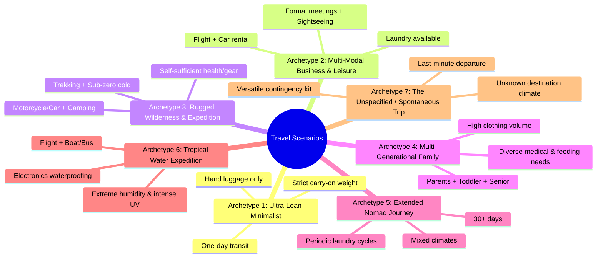

# PackPilot — Comprehensive Scenario Analysis & Matrix

**Document Reference:** SAM-PACKPILOT-V1  
**Version:** 1.0.0  
**Status:** Approved  

---

## 1. Scenario Grouping & Methodology

Rather than creating an unmanageable Cartesian product of thousands of permutations, real-world travel configurations are clustered into seven strategic scenario archetypes representing key operational envelopes.

---

## 2. Deep Dive: 7 Core Scenario Archetypes

### Archetype 1: Single-Day Ultra-Sprint (Day Trip)
- **Profile:** 1-day trip (same start and end date, $D=1$). Transport: Train or Flight. Purpose: Business or Sightseeing.
- **Engine Rules:**
  - Base clothing quantity: 0 spare shirts, 0 spare pants, 1 backup pair of socks/underwear (for emergencies).
  - Heavy luggage items (large toiletry bottles, laundry bags, multiple shoes) strictly suppressed.
  - Portable power bank, travel documents, presentation tech prioritized as `critical`.
- **Validation:** $D=1$ is valid; system sets `isSameDay = true`.

### Archetype 2: The "Bleisure" Trip (Business + Leisure / Beach)
- **Profile:** 6-day trip. Transport: Flight + Rental Car. Activities: Business + Beach + Relaxation. Climate: Warm.
- **Engine Rules (Conflict Resolution):**
  - Blends high-contrast categories: Formal attire (Blazer, Dress shirts $\times 2$, Dress shoes) AND Leisure attire (Swimwear $\times 2$, Flip-flops, Sunscreen).
  - Flight transport triggers TSA liquid warnings and passport carrier.
  - Footwear deduplication: Prevents packing 4 pairs of shoes. Limits to: 1 Dress shoe, 1 Walking shoe (worn in transit), 1 Sandals/flip-flop.
- **Weight Check:** Total estimated weight: ~8.2 kg (triggers warning for standard 7kg carry-on limit, recommending checked baggage or selective culling).

### Archetype 3: High-Altitude Alpine Trek & Camp
- **Profile:** 4-day trip. Transport: Car or Bike. Activities: Trekking + Camping. Climate: Cold / Rainy.
- **Engine Rules:**
  - Cold climate triggers thermal baselayers, fleece midlayer, insulated down jacket, beanie, gloves.
  - Trekking triggers high-ankle boots, trekking poles, blister kit, water purification tablets.
  - Camping triggers 3-season tent, sub-zero sleeping bag, ground pad, compact stove.
  - Deduplication: Waterproof rain shell serves dual purpose as outer windbreaker.
  - Priority overrides: First aid kit elevated to `critical`.

### Archetype 4: Multi-Generational Family Holiday
- **Profile:** 7-day trip. Travellers: 4 (2 Adults, 1 Toddler aged 2, 1 Senior aged 70). Transport: Car or Train. Purpose: Family Trip + Sightseeing.
- **Engine Rules:**
  - Infant/Toddler triggers: Diapers (calculated at $5 \times D = 35$ or travel pack of 20 with buy-on-arrival advisory), wet wipes, pediatric first-aid/fever reducer, portable stroller, travel snacks, change of clothes in daypack.
  - Senior triggers: Daily medication pill organizer, comfortable supportive footwear, accessible route documents, emergency contact card.
  - Documents: Passports / ID copies for all 4 travellers.

### Archetype 5: Extended Nomad / Long-Stay Exploration
- **Profile:** 45-day trip. Transport: Flight + Train. Activities: Sightseeing + Business. Climate: Mixed.
- **Engine Rules (Laundry Scaling):**
  - Uncapped scaling would recommend 45 pairs of underwear and 45 shirts (impossible to pack).
  - Laundry logic kicks in: Caps clothing at 7 days of rotation assuming weekly laundry.
  - Adds laundry travel sheets/detergent strips, travel sink stopper, portable clothesline.
  - Versatile layer system: lightweight layers that combine rather than bulky separate outfits.

### Archetype 6: Tropical Coastal Expedition
- **Profile:** 10-day trip. Transport: Flight + Bus. Activities: Beach + Adventure. Climate: Warm + Rainy (monsoon/tropical shower).
- **Engine Rules:**
  - Waterproof dry-bags for electronics, silica gel packs for camera gear.
  - DEET insect repellent, reef-safe sunscreen, aloe vera cooling gel.
  - Quick-drying synthetic fabrics prioritized over cotton/denim.

### Archetype 7: The Spontaneous / Unknown Climate Trip
- **Profile:** 5-day trip. Climate: `Unknown`. Transport: Car.
- **Engine Rules:**
  - Employs the "Modular Layering Rule": Recommends 1 light rain/wind jacket, 1 warm fleece sweater, and breathable base items.
  - Compact umbrella and versatile walking shoes included.
  - Explanatory note: *"Because climate was unspecified, PackPilot recommended adaptable all-weather layers."*

---

## 3. Comprehensive Scenario Matrix

| Scenario ID | Duration | Transport | Activities | Climate | Travellers & Special Needs | Critical Items Flagged | Est. Weight | Primary Engine Strategy |
| :--- | :--- | :--- | :--- | :--- | :--- | :--- | :--- | :--- |
| **SC-01** | 1 Day | Flight | Business | Unknown | 1 Solo, Work Tech | ID, Flight Ticket, Laptop, Charger | 3.2 kg | Day-pack minimal, no check-in luggage. |
| **SC-02** | 3 Days (Weekend) | Car | Sightseeing, Relaxation | Warm | 2 Couple | ID, Car Docs, Casual Wear | 7.5 kg | Light duffel bag, casual comfort. |
| **SC-03** | 5 Days | Bike / Moto | Adventure, Camping | Mixed | 1 Solo, Minimalist | Helmet, Moto Jacket, Rain suit, Bike Kit | 11.2 kg | Saddlebag optimization, tool kit priority. |
| **SC-04** | 7 Days | Flight + Train | Beach, Sightseeing | Warm | 2 Adults | Passports, Swimwear, Sunscreen, Power bank | 14.8 kg | Split between 2 cabin bags + personal items. |
| **SC-05** | 10 Days | Flight | Trekking, Camping | Cold | 1 Solo, Heavy Gear | Trekking Boots, Sleeping bag, Water filter, Thermals | 18.5 kg | Mandatory checked luggage, safety equipment. |
| **SC-06** | 14 Days | Train | Family trip, Sightseeing | Mixed | 4 (Family + Toddler) | Medication, Stroller, Diapers, IDs | 28.0 kg | Multi-bag management, child essentials prioritized. |
| **SC-07** | 30 Days | Flight + Car | Business, Adventure | Mixed | 1 Solo, Laundry Access | Laptop, Passports, Universal Adapter, 7-day capsule | 12.4 kg | Capsule wardrobe with laundry cap formula. |
| **SC-08** | 4 Days | Train | Sightseeing | Rainy | 2 Seniors, Medications | Daily Rx Meds, Walking canes, Rain shells, IDs | 9.0 kg | Mobility aids, health kit critical weighting. |

---

## 4. Scenario-Specific Test Verification

Every scenario in the matrix corresponds to a dedicated automated unit test file in `tests/scenarios/`:
- `sc-01-day-trip.test.ts`
- `sc-02-weekend-car.test.ts`
- `sc-03-moto-camp.test.ts`
- `sc-04-beach-flight.test.ts`
- `sc-05-alpine-trek.test.ts`
- `sc-06-family-toddler.test.ts`
- `sc-07-extended-laundry.test.ts`
- `sc-08-senior-medication.test.ts`
