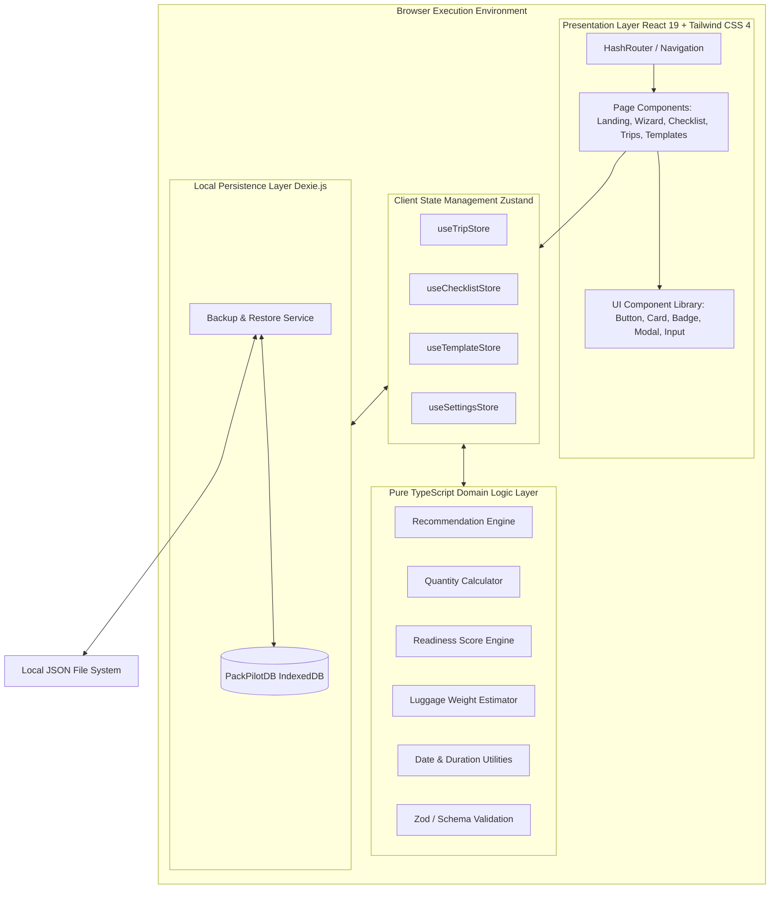
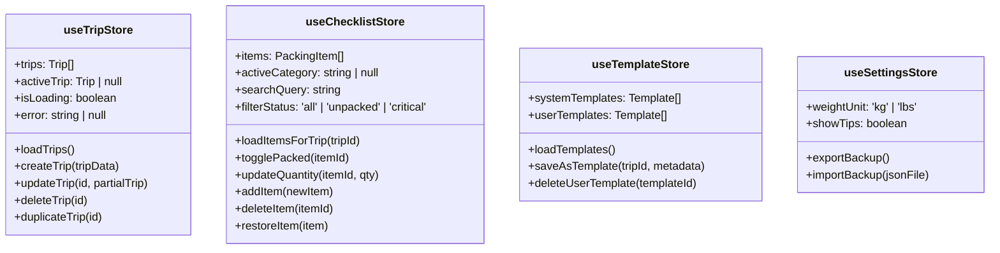

# PackPilot — System Architecture & Technical Design

**Document Reference:** SAD-PACKPILOT-V1  
**Version:** 1.0.0  
**Status:** Approved  

---

## 1. Architectural Style & Constraints

PackPilot is architected as an **Offline-First, Client-Side Single Page Application (SPA)** built with React 19, TypeScript, Vite, Tailwind CSS 4, Zustand, and Dexie.js (IndexedDB).

### Foundational Constraints
- **Zero Backend Services:** No cloud databases, microservices, or authenticated APIs.
- **Data Sovereignty:** All state is persisted locally on the client's browser using IndexedDB.
- **GitHub Pages Static Deployment:** Must deploy cleanly as static HTML, CSS, and JS assets without server-side rewrite rules.



---

## 2. GitHub Pages Routing Architecture

On static hosts like GitHub Pages, requesting deep URLs such as `https://user.github.io/packpilot/trips/123` returns a 404 HTTP status because no file exists at that server path.

### Selected Architectural Strategy: React Router `HashRouter`
- **Route Format:** `https://user.github.io/packpilot/#/trips/123`
- **Why HashRouter?**
  1. The server only ever receives a request for the root document (`index.html`), preventing 404 errors completely.
  2. Works identically across local dev (`npm run dev`), GitHub Pages project subpaths (`/packpilot/`), custom domains, and local file systems (`file:///...`).
  3. Eliminates brittle 404 redirect scripts (`spa-github-pages` hack) that cause flicker and race conditions on deep link reloads.

---

## 3. Zustand State Architecture

PackPilot divides application state into four specialized, focused Zustand stores:



### Store Invariants & Principles
1. **Unidirectional Data Flow:** Views dispatch actions $\rightarrow$ Store calls pure domain logic $\rightarrow$ Store updates in-memory state $\rightarrow$ Store asynchronously commits to IndexedDB.
2. **Debounced Persistence:** Checkbox toggles and quantity adjustments update UI state instantaneously, with IndexedDB updates debounced by 300ms to eliminate storage thrashing.
3. **Atomic Operations:** When creating a trip, the trip record and its 40+ generated items are committed within a single Dexie transaction.

---

## 4. IndexedDB & Dexie.js Data Layer

PackPilot encapsulates all database operations inside a dedicated `db.ts` file extending `Dexie`:

```typescript
// Conceptual Database Architecture
import Dexie, { Table } from 'dexie'
import { Trip, PackingItem, PackingTemplate, AppSettings } from '../types'

export class PackPilotDatabase extends Dexie {
  trips!: Table<Trip, string>
  items!: Table<PackingItem, string>
  templates!: Table<PackingTemplate, string>
  settings!: Table<AppSettings, string>

  constructor() {
    super('PackPilotDB')
    
    // Schema Version 1
    this.version(1).stores({
      trips: 'id, destination, startDate, endDate, createdAt',
      items: 'id, tripId, category, priority, isPacked, [tripId+category]',
      templates: 'id, isSystem, createdAt',
      settings: 'key'
    })
  }
}

export const db = new PackPilotDatabase()
```

---

## 5. Domain Logic Separation

All business calculations are decoupled from React components into pure, deterministic functions:

| Module | Pure Function Signature | Responsibility |
| :--- | :--- | :--- |
| `recommendation/` | `generateRecommendations(config: TripConfig): RecommendedItem[]` | Applies rule pipeline based on trip parameters. |
| `scoring/` | `calculateReadinessScore(items: PackingItem[]): ReadinessScore` | Computes weighted readiness % and flags missing critical items. |
| `weight/` | `calculateLuggageWeight(items: PackingItem[], unit: 'kg' \| 'lbs'): WeightEstimate` | Aggregates reference weights and evaluates airline warnings. |
| `dates/` | `calculateDurationDays(startDate: string, endDate: string): number` | Computes calendar duration using UTC epoch arithmetic. |
| `diffing/` | `mergeChecklists(existing: PackingItem[], updated: RecommendedItem[]): PackingItem[]` | Non-destructive merge when trip parameters are edited. |

---

## 6. Proposed Project Folder Structure

```
c:/GitHub/packpilot/
├── docs/                               # Complete project documentation
│   ├── PRODUCT_VISION.md
│   ├── PRD.md
│   ├── FUNCTIONAL_REQUIREMENTS.md
│   ├── USER_FLOWS.md
│   ├── SCENARIO_ANALYSIS.md
│   ├── EDGE_CASES.md
│   ├── SYSTEM_ARCHITECTURE.md
│   ├── DATA_MODELS.md
│   ├── RECOMMENDATION_ENGINE.md
│   ├── DESIGN_SYSTEM.md
│   ├── TESTING_STRATEGY.md
│   ├── DEVELOPMENT_ROADMAP.md
│   └── TECHNICAL_DECISIONS.md
├── frontend/
│   ├── public/
│   ├── src/
│   │   ├── assets/                     # SVG icons, stamps, texture overlays
│   │   ├── components/
│   │   │   ├── ui/                     # Atoms: Button, Card, Badge, Modal, Input
│   │   │   ├── layout/                 # Header, Footer, PageWrapper, Container
│   │   │   ├── wizard/                 # Steps 1 through 5, WizardNavigation
│   │   │   ├── checklist/              # CategoryAccordion, ChecklistItem, SearchFilterBar
│   │   │   ├── dashboard/              # TripCard, EmptyState, DeleteConfirmModal
│   │   │   ├── templates/              # TemplateCard, TemplatePreviewModal
│   │   │   └── common/                 # ToastNotification, ReadinessMeter, WeightGauge
│   │   ├── db/
│   │   │   ├── index.ts                # Dexie DB instantiation and schema definitions
│   │   │   ├── tripsRepository.ts      # Trip CRUD abstraction
│   │   │   ├── itemsRepository.ts      # PackingItem CRUD abstraction
│   │   │   └── templatesRepository.ts  # Template queries
│   │   ├── engine/
│   │   │   ├── index.ts                # Main recommendation pipeline entrypoint
│   │   │   ├── rules/
│   │   │   │   ├── baseRules.ts        # Mandatory travel essentials
│   │   │   │   ├── activityRules.ts    # Beach, Trekking, Camping, Business, etc.
│   │   │   │   ├── transportRules.ts   # Flight, Bike, Car, Train
│   │   │   │   ├── climateRules.ts     # Cold, Rainy, Warm, Mixed
│   │   │   │   └── preferenceRules.ts  # Medication, Tech, Photography
│   │   │   ├── quantityCalculator.ts   # Duration & laundry scaling math
│   │   │   ├── deduplication.ts        # Canonical item slug collision resolver
│   │   │   └── referenceWeights.ts     # Reference weight lookup table
│   │   ├── hooks/                      # Custom hooks (useTrip, useReadiness, useDebounce)
│   │   ├── pages/                      # Page components (Home, WizardPage, ChecklistPage, etc.)
│   │   ├── stores/                     # Zustand stores (tripStore, checklistStore, etc.)
│   │   ├── styles/                     # tokens.css, components.css
│   │   ├── tokens/                     # index.ts (TypeScript constants for colors, radii, shadows)
│   │   ├── types/                      # Domain interfaces (Trip, PackingItem, etc.)
│   │   ├── utils/                      # Date utilities, export/import service, validators
│   │   ├── App.tsx                     # Top-level Router configuration
│   │   ├── index.css                   # Tailwind v4 import & theme configuration
│   │   └── main.tsx                    # React DOM entry point
│   ├── index.html
│   ├── package.json
│   ├── tsconfig.json
│   └── vite.config.ts
└── README.md
```
