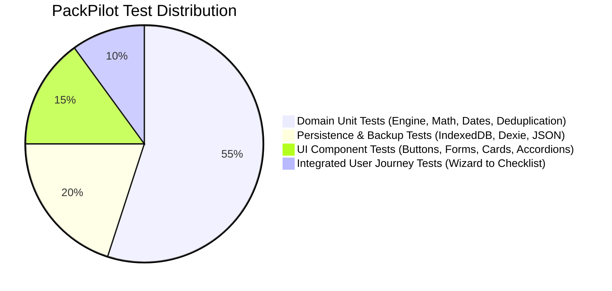

# PackPilot — Comprehensive Testing Strategy & Traceability Matrix

**Document Reference:** TST-PACKPILOT-V1  
**Version:** 1.1.0 (Audited & Revised)  
**Status:** Approved  

---

## 1. Testing Pyramid & Realistic Benchmarks

To achieve true portfolio-grade reliability, PackPilot follows a disciplined testing pyramid emphasizing pure functional unit tests for core domain logic, complemented by component testing and end-to-end integration flows.



### Realistic Engineering Benchmarks
1. **Target Coverage:** $\ge 95\%$ line and branch coverage across all pure domain rules (`src/engine/`) and utility functions (`src/utils/`).
2. **Performance Target:** Engine calculation runs in $< 50\text{ms}$ on standard mobile hardware devices.
3. **Storage Mocking:** Unit and integration tests utilize `fake-indexeddb` to execute cleanly in Node.js test runners without browser dependencies.

---

## 2. Test Tooling & Infrastructure

- **Test Runner:** [Vitest](https://vitest.dev/) (fast, native ESM support integrated directly into Vite).
- **Component Testing:** [@testing-library/react](https://testing-library.com/) & [@testing-library/user-event](https://testing-library.com/).
- **IndexedDB Mocking:** `fake-indexeddb` for Dexie table transaction simulation.
- **Assertion Matchers:** `@testing-library/jest-dom` for accessible DOM assertions.

---

## 3. Feature-to-Test Traceability Matrix

| Feature Area | Module / Function | Test Suite File | Coverage Target | Key Invariants Tested |
| :--- | :--- | :--- | :---: | :--- |
| **Duration Math** | `calculateDurationDays()` | `tests/utils/dates.test.ts` | $\ge 95\%$ | Same-day (1 day), multi-week, leap years, year boundaries, negative diff prevention. |
| **Quantity Scaling** | `calculateDynamicQuantities()` | `tests/engine/quantities.test.ts` | $\ge 95\%$ | $D=1$, $D=5$, $D=14$ with laundry ($cap=7$), consumables scaling by `travellerCount`. |
| **Deduplication** | `deduplicateItems()` | `tests/engine/dedup.test.ts` | $\ge 95\%$ | Merging sunglasses from Beach + Trekking; priority promotion (`critical` wins); union of reasons. |
| **Base Essentials** | `applyBaseRules()` | `tests/engine/baseRules.test.ts` | $\ge 95\%$ | Passport, phone charger, dental kit, wallet present in every generated trip. |
| **Accommodation** | `applyAccommodationRules()` | `tests/engine/accommodation.test.ts` | $\ge 95\%$ | Hostel padlocks/earplugs/shower sandals; Hotel towel suppression; Rental multi-plug. |
| **Activity Rules** | `applyActivityRules()` | `tests/engine/activities.test.ts` | $\ge 95\%$ | Beach items, Trekking boots/poles, Camping tent/stove, Business blazers/laptops. |
| **Transport Rules** | `applyTransportRules()` | `tests/engine/transport.test.ts` | $\ge 95\%$ | Flight TSA liquids/passport, Bike helmet/rain suit/repair kit, Car road kit. |
| **Climate Rules** | `applyClimateRules()` | `tests/engine/climate.test.ts` | $\ge 95\%$ | Cold thermals/down jacket, Rainy waterproof shell/umbrella, Warm breathable fabrics. |
| **Readiness Score** | `calculateReadinessScore()` | `tests/scoring/readiness.test.ts` | $\ge 95\%$ | Weight formula ($3/2/1$); zero penalty for dismissed optional items; dismissed critical item advisory. |
| **Luggage Weight** | `calculateLuggageWeight()` | `tests/weight/estimator.test.ts` | $\ge 95\%$ | Gram to Kg/Lbs conversion; carry-on threshold warning against configured `weightLimitKg`. |
| **IndexedDB CRUD** | `Dexie Database / Repos` | `tests/db/persistence.test.ts` | $\ge 90\%$ | Atomic multi-item writes; debounced updates; query by `tripId` and `category`. |
| **Backup / Restore** | `exportBackup()`, `importBackup()` | `tests/backup/backupService.test.ts` | $\ge 95\%$ | Clean JSON export; corrupted JSON rejection; version mismatch handling; duplicate resolution. |
| **UI Components** | `Button`, `Card`, `Badge` | `tests/components/ui.test.tsx` | $\ge 90\%$ | Variant classes, accessibility attributes, click handlers, loading states, icon rendering. |
| **Wizard Flow** | `TripCreationWizard` | `tests/flows/wizardFlow.test.tsx` | $\ge 90\%$ | Step validation; Next/Back button state; submission and navigation to checklist. |
| **Checklist Actions** | `PackingChecklist` | `tests/flows/checklistFlow.test.tsx` | $\ge 90\%$ | Toggle packed state; add custom item; delete item with undo toast; search filtering. |

---

## 4. Key Test Scenarios & Specifications

### 4.1 Sample Test Spec: Duration & Date Boundary Math
```typescript
describe('calculateDurationDays', () => {
  it('calculates 1 day for same start and end date', () => {
    expect(calculateDurationDays('2026-06-10', '2026-06-10')).toBe(1)
  })

  it('calculates 8 days across a week', () => {
    expect(calculateDurationDays('2026-06-10', '2026-06-17')).toBe(8)
  })

  it('correctly calculates leap year duration', () => {
    expect(calculateDurationDays('2028-02-28', '2028-03-01')).toBe(3)
  })

  it('throws an error if end date precedes start date', () => {
    expect(() => calculateDurationDays('2026-06-17', '2026-06-10')).toThrow()
  })
})
```

### 4.2 Sample Test Spec: Accommodation Rules
```typescript
describe('applyAccommodationRules', () => {
  it('injects padlock and earplugs when hostel is selected', () => {
    const items = applyAccommodationRules({ accommodationType: 'hostel' })
    expect(items.some(i => i.itemSlug === 'gear-hostel-lock')).toBe(true)
    expect(items.some(i => i.itemSlug === 'wear-dorm-earplugs')).toBe(true)
  })

  it('suppresses heavy bath towels when hotel is selected', () => {
    const items = applyAccommodationRules({ accommodationType: 'hotel' })
    const towel = items.find(i => i.itemSlug === 'toil-bath-towel')
    expect(towel?.priority).toBe('optional')
  })
})
```

---

## 5. Deployment & Release Verification (GitHub Pages)

Prior to each production deployment to GitHub Pages, the automated CI pipeline verifies:
1. `npm run lint` — Zero ESLint errors or syntax warnings.
2. `npm run test` — All test suites pass.
3. `npm run build` — Successful Vite production bundle generation (`dist/`).
4. **Relative Path Audit:** Assets in `dist/index.html` link via `./assets/...` rather than `/assets/...` to ensure flawless rendering on `https://<username>.github.io/<repo>/`.
