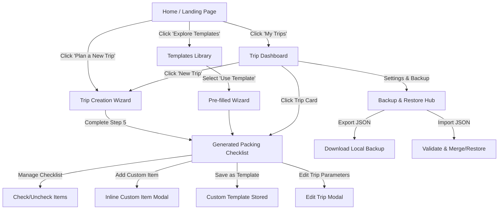
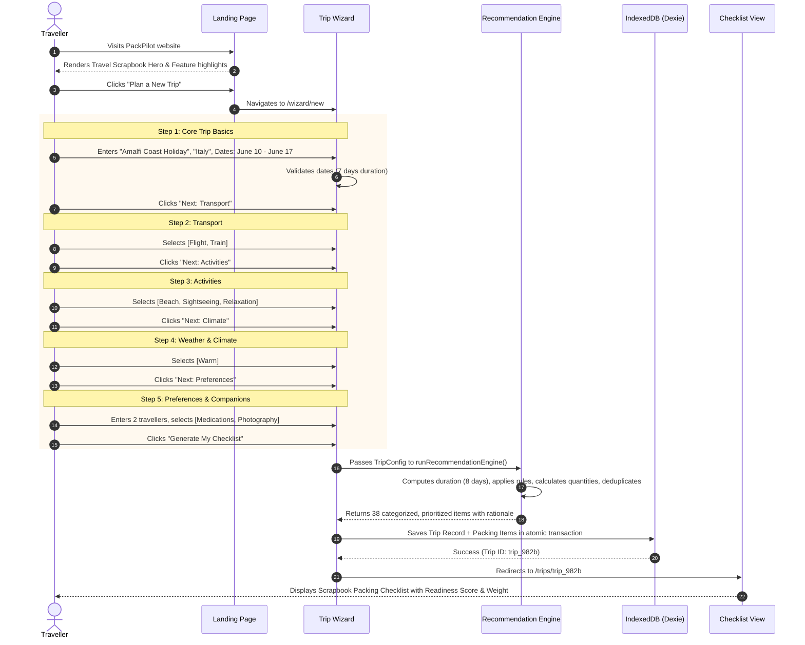
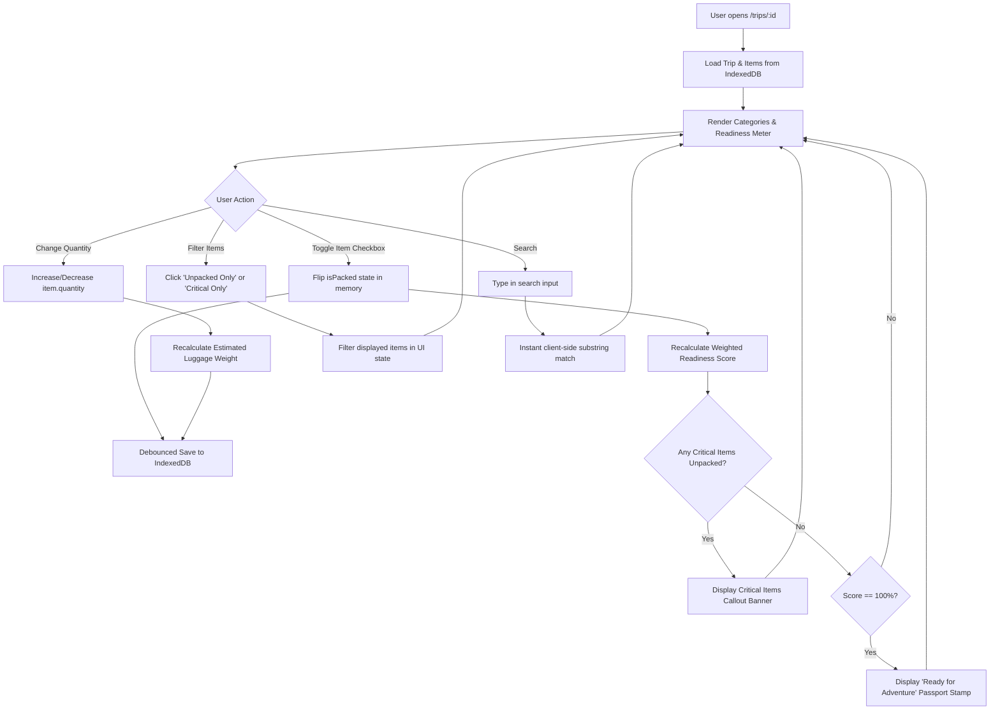
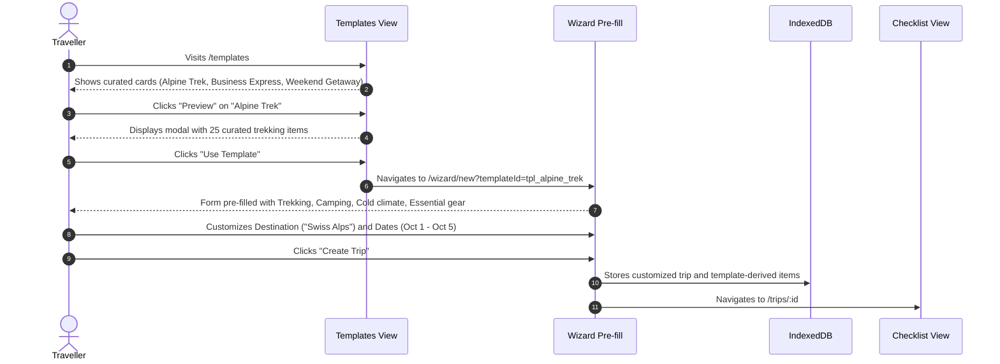
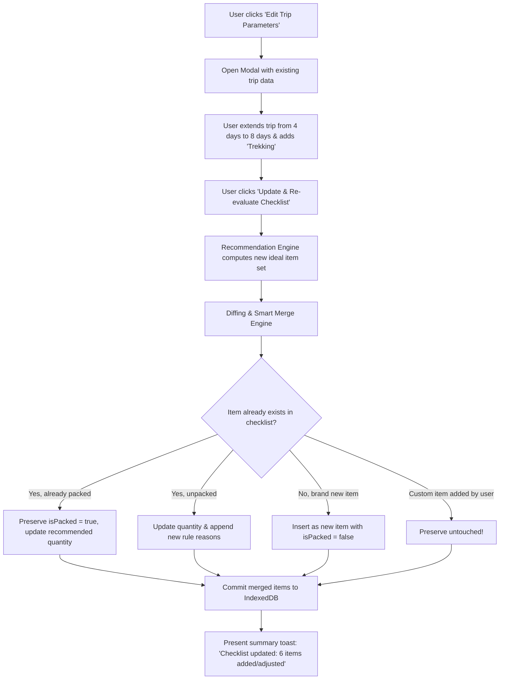
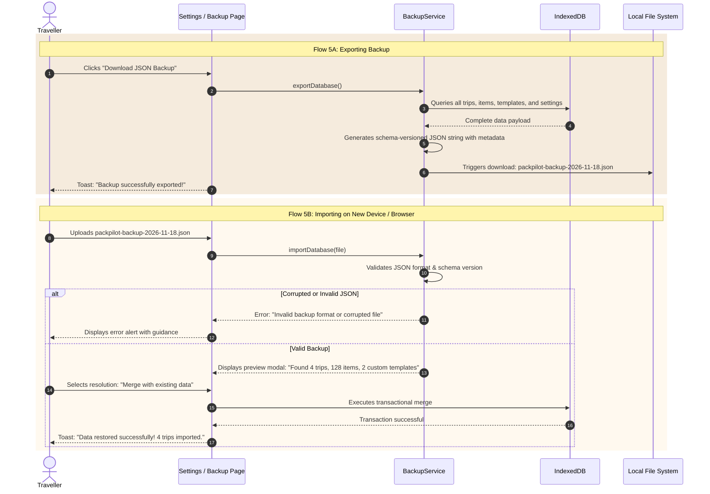

# PackPilot — Complete User Flows & Journey Maps

**Document Reference:** UFD-PACKPILOT-V1  
**Version:** 1.0.0  
**Status:** Approved  

---

## 1. Flow Overview & Global Sitemap

The PackPilot experience is organized around six interconnected core user flows, optimized for zero friction, high speed, and complete privacy:

---

## 2. User Flow 1: First-Time User Experience (Onboarding & First Trip)

---

## 3. User Flow 2: Active Packing & Checklist Interaction

---

## 4. User Flow 3: Template-to-Trip Creation

---

## 5. User Flow 4: Trip Edit & Smart Parameter Recalculation

A frequent real-world scenario is when a traveller extends their trip or changes activities *after* already checking off half their items. PackPilot handles this via an intelligent non-destructive update algorithm:

---

## 6. User Flow 5: Data Backup, Device Migration & Restoration

